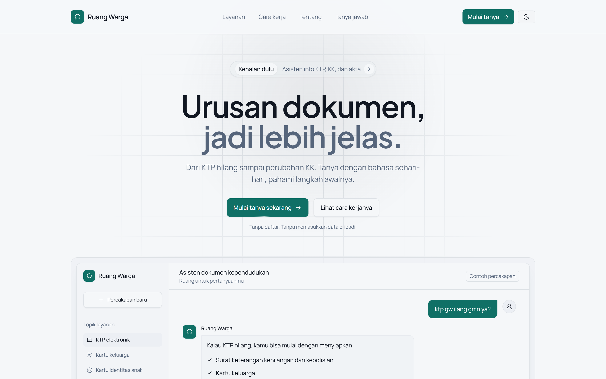
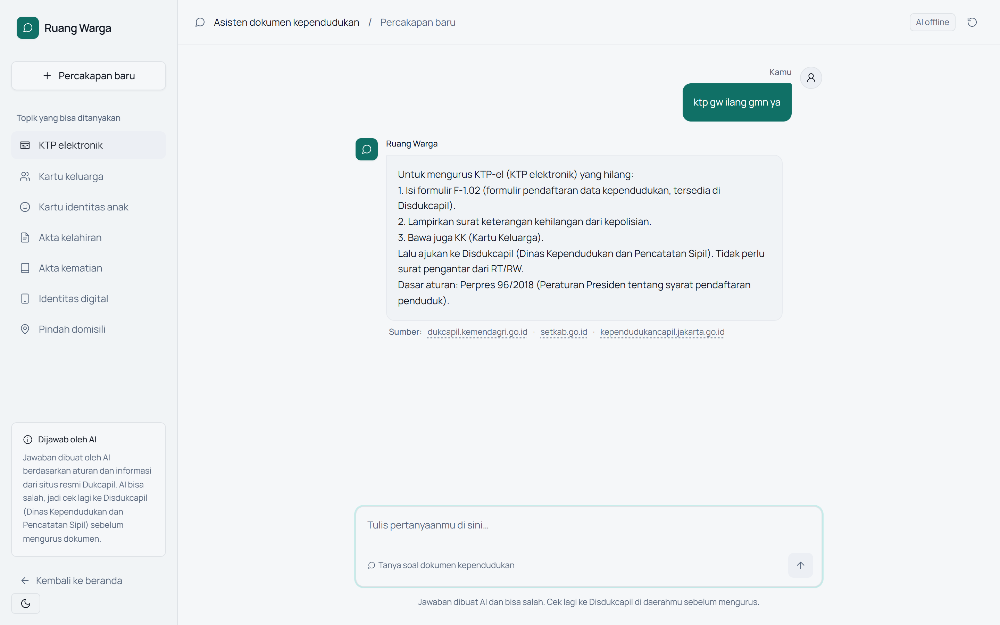

# Ruang Warga

Asisten informasi administrasi kependudukan berbasis Retrieval Augmented Generation yang berjalan sepenuhnya di komputer lokal.

Ruang Warga membantu masyarakat memahami persyaratan dan prosedur dokumen kependudukan seperti KTP, KK, KIA, akta kelahiran, akta kematian, IKD, dan pindah alamat. Pengguna dapat bertanya dengan bahasa sehari hari, termasuk singkatan, bahasa gaul, dan typo. Sistem memilih referensi yang paling relevan dari basis pengetahuan, lalu menyusun jawaban yang ringkas dan terarah.

Ruang Warga adalah alat bantu informasi dan bukan layanan resmi Dukcapil. Selalu verifikasi informasi penting ke kantor Dukcapil setempat.

## Pratinjau





## Fitur utama

### Pemahaman bahasa sehari hari
Pertanyaan dinormalisasi terlebih dahulu menggunakan kamus slang agar kalimat seperti "ktp gw ilang gmn" dapat dipahami sebagai "ktp saya hilang bagaimana".

### Pencarian referensi dua jalur
Retriever menggabungkan pemahaman makna kalimat melalui embedding multilingual E5 Small dengan pencocokan ejaan melalui TF IDF n gram karakter. Gabungan ini membuat pencarian tetap akurat ketika pengguna menulis dengan typo atau singkatan.

### Jawaban yang terkendali
Model bahasa hanya menjawab berdasarkan referensi yang diberikan. Pipeline memeriksa tingkat keyakinan retriever, keterkaitan jawaban dengan referensi, dan aturan kebijakan sebelum jawaban ditampilkan. Jika pertanyaan ambigu, sistem menampilkan pilihan klarifikasi.

### Antarmuka web
Halaman beranda dan halaman chat dibangun dengan Flask, Tailwind CSS, dan komponen bergaya shadcn. Tampilan mendukung mode terang dan gelap serta dapat digunakan pada layar kecil.

### Mode uji tampilan
Mode mock memungkinkan pengembangan antarmuka tanpa memuat model AI. Mode ini tidak memakai model dan tidak ditujukan untuk demonstrasi hasil jawaban.

## Cara kerja

Tahap pertama, pertanyaan pengguna dibersihkan dan dinormalisasi menggunakan kamus bahasa gaul.

Tahap kedua, retriever memeringkat entri basis pengetahuan menggunakan embedding dan kemiripan karakter.

Tahap ketiga, sistem menyusun prompt yang berisi beberapa referensi teratas beserta instruksi untuk tidak mengarang informasi.

Tahap keempat, model bahasa menyusun jawaban. Pipeline kemudian memeriksa keyakinan, grounding, dan kesesuaian jawaban dengan referensi.

Tahap kelima, jawaban akhir dikirim ke antarmuka bersama sumber tautan resmi dan saran pertanyaan lanjutan bila diperlukan.

## Struktur repositori

```
adminduk-chatbot/
├── app.py
├── rag_adminduk.py
├── mock_bot.py
├── rag_config.json
├── system_prompt.txt
├── knowledge_base_adminduk_v4.json
├── slang_id.json
├── requirements.txt
├── templates/
├── static/
├── tests/
├── qwen_adminduk_merged/      model bahasa, tidak disertakan di repositori
└── retriever_e5_small/        model embedding, tidak disertakan di repositori
```

Folder model tidak disertakan karena ukurannya sekitar 1,4 GB. Berkas model didistribusikan terpisah dari repositori.

## Kebutuhan sistem

Python 3.10 sampai 3.12, RAM minimal 8 GB, dan ruang disk sekitar 3 GB. GPU tidak wajib. PyTorch versi CPU sudah cukup untuk menjalankan aplikasi di laptop.

Seluruh proses jawaban berjalan lokal tanpa API berbayar. Koneksi internet hanya dibutuhkan saat memasang dependensi.

## Menyiapkan model

Letakkan dua folder model berikut di direktori utama proyek:

```
qwen_adminduk_merged/
retriever_e5_small/
```

Pastikan folder `qwen_adminduk_merged` berisi `config.json` dan `model.safetensors`, sedangkan folder `retriever_e5_small` berisi `modules.json` dan `model.safetensors`. Hubungi pemilik repositori untuk memperoleh berkas model yang sesuai.

Jika folder model belum lengkap, aplikasi akan berhenti dan menampilkan pesan yang menjelaskan folder mana yang belum tersedia.

## Instalasi

Clone repositori, lalu masuk ke direktori proyek.

```
git clone https://github.com/hamzskiee/adminduk-chatbot.git
cd adminduk-chatbot
```

Windows dengan PowerShell:

```
python -m venv .venv
.\.venv\Scripts\Activate.ps1
python -m pip install --upgrade pip
pip install -r requirements.txt
```

macOS atau Linux:

```
python3 -m venv .venv
source .venv/bin/activate
python -m pip install --upgrade pip
pip install -r requirements.txt
```

Proses instalasi memerlukan waktu lebih lama karena PyTorch.

## Menjalankan aplikasi

```
python app.py
```

Setelah muncul pesan `Server siap: buka http://127.0.0.1:5000`, buka alamat tersebut di browser. Pemuatan model pertama kali memerlukan waktu sekitar 30 sampai 60 detik. Pada laptop tanpa GPU, satu jawaban umumnya memerlukan waktu 5 sampai 15 detik.

Tekan `Ctrl + C` di terminal untuk menghentikan server.

## Mode uji tampilan

Gunakan mode ini hanya untuk memeriksa antarmuka tanpa memuat model AI.

Windows dengan PowerShell:

```
$env:ADMINDUK_MOCK="1"
python app.py
```

macOS atau Linux:

```
ADMINDUK_MOCK=1 python app.py
```

Jawaban pada mode ini berasal dari tiruan dan tidak boleh dipakai untuk demonstrasi kualitas model.

## Konfigurasi

Pengaturan pipeline tersimpan di `rag_config.json`. Nilai `top_k` menentukan jumlah referensi yang dipertimbangkan, `min_confidence` menentukan ambang keyakinan retriever, dan `min_grounding` menentukan ambang keterkaitan jawaban dengan referensi. Nilai `saran_k` mengatur jumlah saran pertanyaan lanjutan.

Beberapa variabel lingkungan yang tersedia:

`PORT` mengganti port server. Nilai bawaan adalah 5000.

`ADMINDUK_MOCK` mengaktifkan mode uji tampilan ketika diisi `1`.

`ALLOWED_ORIGIN` mengatur nilai header CORS. Nilai bawaan adalah `*`.

`HF_HUB_OFFLINE` dan `TRANSFORMERS_OFFLINE` memastikan model tidak mengunduh berkas dari internet.

## API

### GET /health

Memeriksa status server.

```
{
  "status": "ok",
  "device": "cpu",
  "intents": 81,
  "mock": false
}
```

### POST /api/chat

Endpoint utama yang dipakai halaman web.

```
curl -X POST http://127.0.0.1:5000/api/chat \
  -H "Content-Type: application/json" \
  -d "{\"pertanyaan\":\"ktp saya hilang, apa syaratnya\"}"
```

```
{
  "jawaban": "Untuk mengurus KTP-el (KTP elektronik) yang hilang: 1. Isi formulir F-1.02 (formulir pendaftaran data kependudukan, tersedia di Disdukcapil). 2. Lampirkan surat keterangan kehilangan dari kepolisian. 3. Bawa juga KK (Kartu Keluarga). Lalu ajukan ke Disdukcapil (Dinas Kependudukan dan Pencatatan Sipil). Tidak perlu surat pengantar dari RT/RW.",
  "sumber": [
    {"url": "https://dukcapil.kemendagri.go.id", "label": "dukcapil.kemendagri.go.id"}
  ],
  "saran": [
    {"label": "KTP saya hilang, apa saja syarat mengurusnya?", "pertanyaan": "KTP saya hilang, apa saja syarat mengurusnya?"}
  ]
}
```

### POST /chat

Endpoint versi lama yang tetap tersedia untuk pengujian dan integrasi. Respons memuat `jawaban`, `intent`, `topik`, `sumber`, `skor`, `mode`, dan `saran`.

### GET /

Menampilkan halaman beranda.

### GET /chat

Menampilkan halaman chat.

## Pengujian

```
python -m unittest discover tests
```

Pengujian memeriksa logika koreksi retriever, aturan saran, aturan kebijakan, dan konsistensi basis pengetahuan tanpa memuat model bahasa.

## Basis pengetahuan

Seluruh jawaban mengacu pada `knowledge_base_adminduk_v4.json`. Setiap entri memiliki `intent`, `kategori`, `topik`, `sumber`, `jawaban`, dan `contoh_pertanyaan`.

Field `jawaban` berisi teks yang ditampilkan ke pengguna. Field `jawaban_latih` berisi kalimat yang dipakai saat pelatihan model dan tidak boleh dihapus karena digunakan untuk memeriksa kemiripan jawaban. Field `label_saran` menyimpan teks tombol klarifikasi. Field `fakta_kunci` dipakai oleh pengujian untuk memastikan fakta penting tetap ada di dalam jawaban.

Kamus bahasa gaul tersimpan di `slang_id.json`, sedangkan instruksi sistem untuk model tersimpan di `system_prompt.txt`.

## Batasan

Ruang Warga tidak memproses data pribadi dan tidak menggantikan layanan resmi pemerintah. Kualitas jawaban bergantung pada cakupan basis pengetahuan dan kemampuan model yang berjalan di perangkat lokal. Pada perangkat tanpa GPU, waktu jawaban lebih lama dibanding layanan berbasis cloud.

## Kredit dan lisensi komponen

Antarmuka memakai komponen Tailark dan shadcn dengan lisensi MIT, serta font Plus Jakarta Sans dan Manrope dengan lisensi SIL Open Font License. Berkas lisensi tersedia di `static/licenses`.

Retriever memakai model multilingual E5 Small dengan lisensi MIT. Model bahasa menggunakan arsitektur Qwen2 yang telah disesuaikan untuk domain administrasi kependudukan.

Aplikasi dibangun dengan Flask, PyTorch, Transformers, Sentence Transformers, dan scikit learn.
